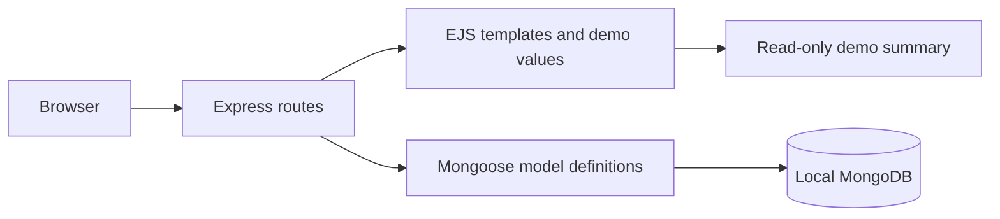

# Movie Ticketing

A cinema seat-booking app, written as an early student project. You can browse films, pick a cinema and showtime, choose seats, inspect demonstration payment and watch-history pages. This is a UI prototype, not a functioning ticket sales system.

It's an Express app with server-rendered HTML views (EJS) and MongoDB through Mongoose.


## Pages

- `/` and `/landing.html`: catalogue introduction and demo navigation
- `/index.html/:movie_title`: film details
- `/cinemalist.html`: list of cinemas
- `/select.html/:cinema_name`: seat selection
- `/payment.html` and `/paymentsummary.html`: demonstration payment screens; no charge or reservation is made
- `/watchhist.html`: booking history
- `/user.html`: user profile

Views are in `app_server/views`, controllers in `app_server/controllers` and Mongoose models in `app_server/models`.

## Run with Docker

```bash
docker compose up -d --build
```

This defines MongoDB 7 and the app on http://localhost:3700. Container startup has not been verified here; native MongoDB startup and route checks were exercised.

## Run without Docker

Use Node 22 and a local MongoDB.

```bash
npm ci
MONGODB_URI=mongodb://localhost:27017/ticketing npm start
```

The app listens on port 3000 by default (`PORT` to change it). If `MONGODB_URI` isn't set it uses `mongodb://localhost:27017/ticketing`.

## Tests

There's a small smoke test suite in `tests/` using the built-in Node test runner. It needs the app and MongoDB running:

```bash
APP_URL=http://localhost:3000 npm test
```

The tests check that every route responds, that GET requests don't write to the database, that the connection string comes from the environment, and that only `db.js` opens a database connection.

## Limitations

This is early work and a lot of it is unfinished:

- Most controllers render hardcoded data rather than querying the database.
- There is no authentication or session service; the landing page links to demonstration screens.
- The user model stores `password` as a plain string with no hashing, so that needs fixing before any signup flow is added.
- The UI uses "BookMyShow" branding from when it was a practice clone.

## Request flow



Film details and payment summaries are read-only GET requests. Selection handlers
respond with a page or redirect instead of retaining a process-global selection.
Demo summaries validate quantities and explicitly state that no payment or seat
reservation took place. Real ticket sales would require authentication, an atomic
seat reservation and a server-verified payment provider callback.

The dependency lock no longer includes `event-stream@3.3.6` or `flatmap-stream`.
The obsolete watcher chain was replaced with nodemon 3, unused request/path packages
were removed, and EJS/Express were updated. Those affected package references remain
in older commits because repository history is preserved. See the
[npm incident report](https://blog.npmjs.org/post/180565383195/details-about-the-event-stream-incident.html).
A lockfile reference establishes an unsafe dependency selection, not proof that its
payload ran on a developer machine.

Earlier commits also contain a disclosed database credential. Its revocation has
not been confirmed; removing it from current files does not revoke it.

## Author

[**Muhammad Nadeem**](https://github.com/dev-mnadeem)
