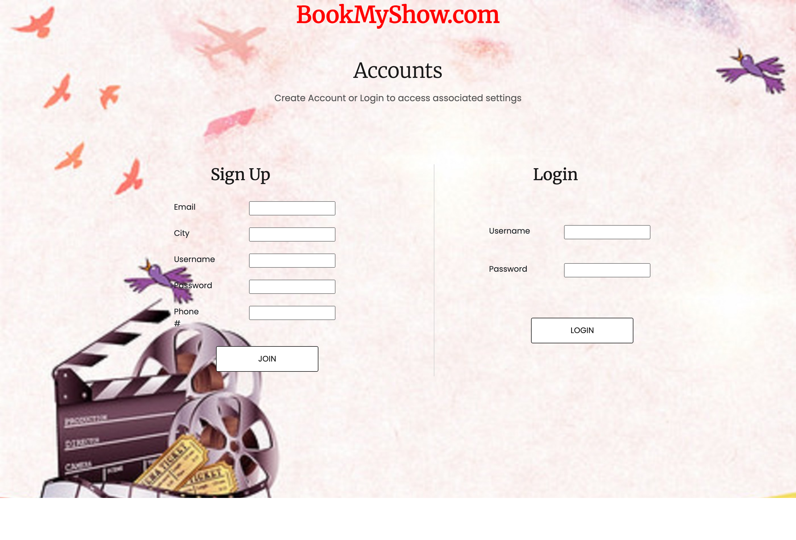

# Movie Ticketing

A cinema seat-booking app, written as an early student project. You can browse films, pick a cinema and showtime, choose seats, go through a payment page and see a watch history.

It's an Express app with server-rendered HTML views (EJS) and MongoDB through Mongoose.



## Pages

- `/` and `/landing.html`: landing / account screen
- `/index.html/:movie_title`: film details
- `/cinemalist.html`: list of cinemas
- `/select.html/:cinema_name`: seat selection
- `/payment.html` and `/paymentsummary.html`: payment flow
- `/watchhist.html`: booking history
- `/user.html`: user profile

Views are in `app_server/views`, controllers in `app_server/controllers` and Mongoose models in `app_server/models`.

## Run with Docker

```bash
docker compose up -d --build
```

This starts MongoDB 6 and the app. Open http://localhost:3700.

## Run without Docker

You need Node and a local MongoDB.

```bash
npm install
MONGODB_URI=mongodb://localhost:27017/ticketing npm start
```

The app listens on port 3000 by default (`PORT` to change it). If `MONGODB_URI` isn't set it uses `mongodb://localhost:27017/ticketing`.

## Tests

There's a small smoke test suite in `tests/` using the built-in Node test runner. It needs the app and MongoDB running:

```bash
APP_URL=http://localhost:3000 npm test
```

The tests check that every route responds, that GET requests don't write to the database, that the connection string comes from the environment, and that only `db.js` opens a database connection.

## Limitations

This is early work and a lot of it is unfinished:

- Most controllers render hardcoded data rather than querying the database.
- The signup and login forms aren't wired up, and there's no authentication or sessions.
- The user model stores `password` as a plain string with no hashing, so that needs fixing before any signup flow is added.
- The UI uses "BookMyShow" branding from when it was a practice clone.
